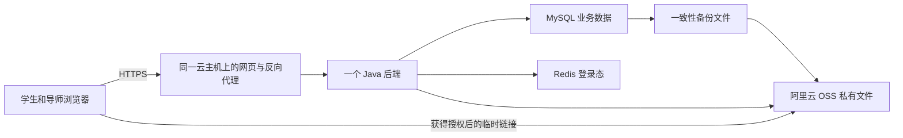

# UP-SELF：MVP 范围、权限、部署与预算决策稿

版本：0.1，供开发前确认。整理日期：2026-10-21。

## 1. 先确定一个可交给学生使用的版本

第一版目标：**学生登录后能学习一门包含视频、图片和文字的课程，提交作业，收到导师评分与反馈；每周记录一次心情并查看历史变化；导师能发布课程公告。**

本轮已明确：使用者以马来西亚为主；首批 10–30 名学生；学习、作业批改、每周心情和导师发帖优先；群聊等随后开发；预算尚未确定，需要比较可行范围。

建议采用：**三种业务角色 + 原 Java 多模块单体 + 一台 4GB 云主机 + 自建 MySQL/Redis + 原项目已有的阿里云 OSS**。先做受邀小范围试用；云主机选择新加坡或吉隆坡，按账号可购买套餐、价格和学生实际网络测试确定。不预先买一年、不购买高可用集群。

本文件是原《毕业项目 Java 后端开发标准》的业务补充。后端版本、Maven 分层、异常、分页、Security、Mapper 和 Flyway 按原标准保持；本轮只作决策与排期，不创建业务工程或执行部署。

## 2. 与毕业报告的对应及差异

核查报告 5.4.1 的表 5.1–5.8，编号确为 FR-01 至 FR-61；PDF 实际第 30–38 页，对应正文第 14–22 页。非功能要求在 PDF 第 39 页，技术栈和概念 ER 图在第 46 页。

报告写明 React、Spring Boot、MySQL，和已选后端方向一致。Figure 5.1 的 Level 1–4 是功能分组，没有要求把系统部署为四套服务；概念 ER 图也还没有完整表达课程成员、导师负责关系、文件归属和提交版本。这些关系需要在 MVP 业务细化时补足。

| 事项 | 原报告 | 本轮执行依据 |
|---|---|---|
| 心情频率 | FR-21 是 Record Daily Mood | 按本轮明确要求改为每周一次；保留 FR-21 的追踪关系，记录需求变更 |
| 心情历史 | FR-22 View Mood History | 首版实现周记录与趋势图 |
| 导师发帖 | 61 条中没有独立定义“发布帖子”的 FR | 增补 MVP-POST-01；先按课程内文字/图片公告理解，不算 FR-59 的完整实现 |
| 导师看学生 | FR-56/57 | 首版只做所负责学生的学习、作业和经允许分享的心情简表 |
| 图形/视频资源 | 学习模块描述学习内容，FR-52 管理课程资源 | 本轮明确需要视频和图片，纳入课程资源模型 |
| AI、群聊、商业模拟 | 原报告完整功能范围 | 保留在后续计划，不列入首版验收 |

周心情与课程公告应同步到报告/需求追踪记录；这不是“已完成 61 条 FR”。附录 A 对全部 61 条给出阶段归属，避免遗漏，也避免首版无限扩大。

## 3. MVP 必须覆盖的用户流程

### 3.1 学生

1. 使用管理员预先建立的账号登录，修改自己的密码。
2. 看见已发布课程目录、搜索课程、查看介绍；只有已加入课程才能访问受限章节和作业。
3. 阅读文字/图片、播放 MP4 视频；保存最后章节和播放位置，重新登录仍能继续。
4. 查看作业说明、截止时间，保存文字草稿，上传 PDF/JPG/PNG 作业并提交。
5. 截止前可提交新版本；查看每次正式提交及对应的导师反馈。
6. 每周填写一次总体心情，可修改本周记录，查看最近 8–12 周记录。
7. 阅读自己课程内的导师公告。

基础无障碍设置纳入首版：三档字号、高对比度、明确的按钮文字、键盘可操作、视频不自动播放；视频附简短文字说明。TTS 独立列为后续，不将尚未实现的 FR-09/NFR-01 标为完成。

### 3.2 导师

1. 登录管理入口，仅看到被分配给自己的课程和学生。
2. 创建、修改、发布本课程作业，设置截止时间。
3. 查看提交列表，安全预览/下载附件，为指定提交版本评分并写评语。
4. 查看本课程学生进度、待批改数量。
5. 发布、编辑、下架自己在负责课程中的文字/图片公告。
6. 查看明确允许向自己分享的学生心情；没有分享权限时不返回记录内容。

“导师发帖子”在本稿中解释为课程公告，不含公共社区、点赞、评论、关注、实时讨论和陌生人私信；如果实际想要社区帖，应在开工前补充该差异。

### 3.3 管理员

1. 建立/停用学生和导师账号，分配业务角色。
2. 创建课程和章节、绑定视频/图片资源，设置负责导师、加入学生。
3. 处理课程/公告下架等管理工作，查看系统审计记录。
4. 管理员不默认获得任意学生的心情自由文本或作业内容查看权；需要内容支持时采用单独业务授权与审计。

初版账号由管理员创建，暂不增加开放注册、短信验证、外部 SSO 和复杂邀请系统，减少角色冒领和开发/运营成本。

## 4. 三种角色与数据权限

### 4.1 角色建议

| 业务角色 | 建议 roleKey | 范围 |
|---|---|---|
| 学生 | student | 自己的数据，以及已加入课程的内容 |
| 导师 | mentor | 自己负责课程的教学数据和被明确授权的学生数据 |
| 平台管理员 | platform_admin | 账号、角色、课程分配、内容管理和运维记录 |

每个账号先沿用参考项目 `sys_user.role_id` 的单主角色；课程/学生关系是业务关系，不是新增登录角色。一个学生可加入多门课程；第一版每门课一个负责导师，管理员维护关系。学生跨课有多个导师时，心情分享对象应明确指定，不能自动向所有授课导师公开。

reference 中 userId=1、roleId=1、部分 roleKey=admin 有超级管理员特殊语义。普通“平台管理员”使用受限业务角色 platform_admin，不因名字像管理员就给 `*:*:*`。如保留参考超级管理员作维护账号，它不作为日常使用账号；敏感数据的 Service 归属检查也不自动为其跳过。

### 4.2 权限矩阵

| 操作 | 学生 | 导师 | 平台管理员 |
|---|---|---|---|
| 浏览已发布课程介绍 | 可 | 可 | 可 |
| 看完整章节/资源 | 已加入课程 | 自己负责课程 | 课程内容管理范围 |
| 创建课程、分配导师/学生 | 不可 | 不可 | 可 |
| 修改自己的学习进度 | 可 | 不可 | 不可直接冒充学生修改 |
| 创建/发布作业 | 不可 | 自己负责课程 | 管理权限范围，不能冒充导师评分 |
| 提交/重交作业 | 仅自己，且在有效时间内 | 不可替学生提交 | 不可替学生提交 |
| 下载作业附件 | 自己的提交 | 自己课程的提交 | 默认不可，另行授权 |
| 评分/反馈 | 不可 | 自己课程的指定提交版本 | 默认不可 |
| 发课程公告 | 不可 | 自己负责课程 | 内容管理/下架权限，不能冒用导师身份 |
| 修改自己的心情 | 仅本周自己的记录 | 不可修改学生记录 | 不可修改学生记录 |
| 查看心情 | 自己 | 被指定且获分享许可 | 默认不可读具体内容 |
| 分配账号角色 | 不可 | 不可 | 可 |

该矩阵是针对 UP-SELF 的业务建议，不是参考代码已经自动具有的全部能力。

### 4.3 后端怎样真正落实

权限采用参考的 `@PreAuthorize("@ss.hasPermi('...')")`、菜单 perms、角色菜单关联。示例业务标识：

| 权限 | 业务用途 |
|---|---|
| learning:course:list / query | 课程目录与详情 |
| learning:progress:save | 更新本人进度 |
| assignment:task:add / edit | 导师维护负责课程作业 |
| assignment:submission:submit / query | 本人提交与查看 |
| assignment:review:grade | 导师批改 |
| mentor:post:add / edit / remove | 课程公告 |
| wellbeing:mood:save / history | 本人周心情 |
| wellbeing:mood:sharedQuery | 指定导师查看分享记录 |

接口权限之后必须继续检查数据：是否已加入课程、是否负责导师、提交是否属于本人、记录是否已允许分享。userId/mentorId/creator 从服务端登录态取得，不信任客户端传来的身份字段。

参考工程 DataPower/FieldAspect 等并未形成有效的完整数据隔离，本项目采用已有有效模式：Service 明确判断，Mapper SQL 带业务关系条件。不能通过隐藏按钮、修改 URL 或知道文件 key 就绕过授权。

验收至少覆盖：学生 A 请求学生 B 的提交、导师 A 批改导师 B 课程、学生自己改 roleId、已退课学生访问文件、管理员普通账号读取未分享心情，均被拒绝。

## 5. 登录校验：两个入口，沿用同一套认证技术

建议继续沿用参考已有的两类认证入口，而不是为三个角色部署三个系统：

| 入口 | 使用者 | 处理 |
|---|---|---|
| 学生入口，基于 /client/login 适配 | student | 从毕业项目自己的用户库认证，移除原 CRM 身份依赖 |
| 管理入口，基于 /empLogin 和 TOTP 步骤 | mentor、platform_admin | 使用原后台认证链、权限加载与两步登录机制 |

界面可做一个登录页，分“学生入口”和“导师/管理入口”；用户选择入口不授予角色，后端仍以数据库角色核验。管理链中参考内部 authority 名称 admin 只表示进入管理认证链，不等于业务超级管理员；学生链原 crm 身份标识改为毕业项目自己的学生身份。

流程：账号密码 → 用户存在/停用/角色检查 → 参考密码校验流程 → 管理端按已开启配置完成 TOTP → 服务端加载权限 → JWT 签发 → Redis 保存登录态 → 后续请求经过 JWT 过滤器及权限检查。

- 保持 Spring Security 5.5.8、JJWT 0.9.1、原 TokenService/Redis TTL 思路；默认 120 分钟滑动有效期按原配置处理。
- 密码创建、修改、重置与参考的 MD5 预处理 + BCrypt 存储流程保持一致，避免部分入口重复 MD5 或少做一步。
- 新工程使用独立 JWT/TOTP 密钥、Redis 配置和数据库，不使用原 CRM/员工账号与任何实际凭证。
- 保留现有密码失败计数、锁定和 token 注销能力；重置密码/停用账号后应撤销该账号已有登录态，需在迁移实现中核对调用点。
- role、权限、文件归属全部由后端确定；前端路由控制只是界面体验。
- 学生不被要求使用管理端 TOTP；管理端先沿用参考已开启模式，是否调整另作明确决策。
- 沿用既有异常和响应；在接口联调前记录原项目 HTTP status 与 JSON code 的差异，不能默认所有失败均为 HTTP 401/403。

这部分必要适配集中在“自己的用户数据、角色与路由”，不换认证框架、不接入新账户平台。

## 6. 每周 Mood Tracking 的准确含义

建议定义为**每周一次的总体感受自评**，不把一次周记录描述成每天连续监测。

| 规则 | 建议首版行为 |
|---|---|
| 时区 | Asia/Kuala_Lumpur；由服务端确定日期和周归属 |
| 周期 | 周一 00:00 到下周一 00:00，左闭右开 |
| 填写 | 五档心情，配文字标签和图标，可选一段简短备注 |
| 数量 | 每人每周一条；本周可修改，保存最后更新时间 |
| 约束 | 对学生和 week_start 做唯一约束，不靠前端禁用按钮防重复 |
| 历史 | 首版历史只读，不允许任意回填过去周以制造连续记录 |
| 提醒 | 登录首页显示本周待填写，可稍后填写；不挡住课程学习 |
| 图表 | 最近 8–12 周，每周真实记录一个点；连续相邻周可连线 |
| 缺失 | 显示“未填写”，图中断开，不填成 0、不擅自插值 |
| 连续性 | 显示连续填写周数，不称为连续每日打卡 |
| 分享 | 默认自己可见；学生可明确分享给指定导师并取消后续访问 |

心情等级是主观分类，不计算“情绪提高 40%”等伪精确结论。图表只反映实际填写记录，不自动诊断、推断高风险或发送 FR-58 警报。导师能否看备注必须与学生的分享选择一致，不能仅授权图表却把备注一起返回。

真实上线第一周只能自然积累第一周的数据。演示多周趋势可用独立演示账号的合成记录，明显标注“演示数据”；不能往真实学生历史里填造假数据。

## 7. 学习、作业和公告需要先固定的少量规则

### 7.1 学习

课程有发布/下架状态；章节按顺序展示，支持文字、图片、MP4 资源。目录介绍可给已登录用户浏览，正文及资源由加入课程的学生和负责导师访问。

视频保存最后播放位置，结束时更新章节完成状态；图文章节使用明确“已完成”按钮。课程进度按已完成章节占总章节数计算；“打开过”与“完成”分开。首版不加入考试监考、防作弊视频识别或在线转码。

### 7.2 作业

- 基础状态为草稿、已提交、已批改；每次正式重交产生新版本，保留旧版本和旧批改，不直接覆盖。
- 截止时间由后端校验；截止后不接受普通学生重交。需要延期时由有权限的导师调整相应作业期限。
- 若已批改的作业在截止前重交，新版本回到待批改状态，旧分数与旧反馈仍属于旧版本。
- 评分操作绑定 submission/version，避免导师在学生重交后把旧版本反馈错误覆盖到新版本。
- 评分范围建议 0–100，评语提供清楚的可改进说明；具体量表可在开工前由导师确定。
- 草稿文字每 30 秒在有改动时保存，并显示保存成功/失败；附件上传完成后保存附件关联，不每 30 秒重新上传整个文件。自动保存不等于正式提交。
- 首版上传 PDF/JPG/PNG，建议单文件不超过 10MB；文件类型、实际内容、大小和归属均校验。上传完成与正式提交分别确认。

### 7.3 公告

课程内公告含标题、正文、可选图片、发布时间、作者和发布状态。学生只读，导师只能维护自己负责课程内的本人公告，管理员可下架不适当内容。反馈通道先用作业评语，群聊与评论随后单独开发。

## 8. 基本架构与数据库部署

### 8.1 保留已核验的技术架构

后端继续使用 Java 8、Spring Boot 2.5.14、原六类 Maven 模块、原 MyBatis/MP/PageHelper 组合、Druid、Spring Security/JWT/Redis 和 Flyway 7.7.3，其他版本以原标准完整清单为准。前端使用报告提出的 React；React 具体版本尚未从现有前端工程核验，本稿不凭空填版本。

学习、作业、心情、公告放在同一个 biz 模块的不同业务包，HTTP Controller 放 admin；不为四个功能新建四个服务。权限、通用工具及配置在既有位置扩展。



网页、后端、MySQL、Redis 初期可位于同一云主机；图中的逻辑组件不表示都需要各买一台机器。文件与数据库备份放独立存储，避免机器损坏时一起丢失。

### 8.2 本地电脑的用途

你的电脑适合开发、运行本地数据库和演示。学生长期访问的版本放云主机或确实获得的学校服务器；电脑关机、网络变化或家庭断网不应导致网站停止。上线后你的电脑可以关机，网站由云服务器运行。

### 8.3 MySQL 怎么放

**首版建议：MySQL 与后端同机。** 这是部署成本最小的一档，同一台机器不意味着学生能直接连数据库；浏览器只访问 HTTPS API，MySQL/Redis 只监听本地或私有网络，禁止公网开放 3306/6379。

- 云服务器磁盘持久保存数据库，重启 Java 应用不删除数据库；数据库也不能放在临时构建目录。
- 业务账号、迁移账号和维护访问按实际用途配置，不把真实密码写进前端或上传到代码仓库。
- 保留 Flyway 独立连接配置，指向毕业项目自己的 schema；从毕业项目真正的初始化迁移起步，不能直接使用参考空 V1 后假定表存在。
- 参考工程 MySQL/Redis 服务端确切版本尚未确认。安装或购买云数据库前核实版本、JDK 8 运行包和 DDL 兼容性，不让云平台默认最新版本替代原标准。
- 每天自动进行一致性数据库备份，放私有 OSS 并检查成功状态，试用前做一次实际恢复测试。只备到同机磁盘不够。
- 每日备份的基本恢复目标可能损失最多约一天的数据；如作业提交阶段需要更短恢复间隔，可增加备份频次。重新登录不丢进度的 NFR-08 不等于机器故障时零数据丢失。
- 单机故障可能使网站暂时不可用，需你负责恢复。是否改用托管数据库取决于后续预算和维护意愿，不是首批 10–30 人自动需要高可用集群。

托管 MySQL 是第二档方案：把同一业务库放到云厂商的数据库服务，Java 仍走原 Druid/Mapper/Flyway。它可减少部分维护工作，但不会自动实现业务权限或消除恢复测试需求；先核对引擎版本和备份能力。

### 8.4 视频、图片、作业分别怎么存

数据库保存课程、章节、提交、权限关系和文件 object key/元数据；**不把视频或 PDF 二进制塞入 MySQL**。文件继续用参考项目已有阿里云 OSS SDK 3.15.1。

作业必须使用私有访问：先请求后端，后端核验本人/负责导师，再生成有有效期的访问链接。已经在本地 SDK 接口中确认 `generatePresignedUrl` 存在，不需要为此换存储 SDK；参考现有直接拼 URL 的返回方式需要针对私有文件作必要适配。[OSS 临时链接说明](https://www.alibabacloud.com/help/tc/oss/user-guide/how-to-obtain-the-url-of-a-single-object-or-the-urls-of-multiple-objects)

课程视频建议也使用受控访问。视频临时链接有效时间要覆盖播放或支持过期后重新获取，不能让短链接在播放中途导致无法继续。临时链接可在有效期内被持有人使用，因此不要向无权限用户发放，也不要将它当成 DRM。

原全局上传上限是单文件 15MB、总请求 20MB，普通扩展名配置也没有覆盖完整视频需求，不能声称已支持任意大 MP4 上传。第一版由管理员先在 OSS 控制台上传预压缩 MP4，在课程后台绑定资源，避免先开发大文件分片和转码系统；学生小文件上传继续走原有服务。以后需要导师浏览器直传时，再用同 SDK 的签名能力扩展。

新加坡/吉隆坡适合本轮用户地域；阿里云官方列出两地区，且同账号同地区的轻量服务器与 OSS 可走内部网络。地区与计费以实际购买页为准。[地区及网络说明](https://www.alibabacloud.com/help/en/simple-application-server/product-overview/regions-and-network-connectivity)

## 9. 上线平台与月费对比

### 9.1 比较口径

价格核对日期：2026-10-21。下表是公开页面的美元价格，**不是已下单报价**；税、汇率、地区/库存、额外磁盘、网络超额、优惠和续费可能改变实付。

为了比较预算，统一按 **US$1 = RM4.50** 换算；这是刻意采用的预算假设，不是实时外汇报价。购买时换成银行卡/账单的实际汇率。

### 9.2 可原样运行当前后端的云主机

| 平台 | 公开套餐 | 服务器月费 | 按预算汇率折 RM | 适用判断 |
|---|---|---:|---:|---|
| 阿里云国际站轻量 | Linux，1 核/2GB/40GB | US$9 | RM40.50 | 低预算开发/演示；Java+MySQL+Redis 同机余量小 |
| DigitalOcean Basic Regular | 1 核/2GiB/50GiB | US$12 | RM54.00 | 同样属于需要调优的低配档 |
| AWS Lightsail | Linux，2 核/2GB/60GB，含公网 IPv4 | US$12 | RM54.00 | 低配演示档，仍受内存约束 |
| **阿里云国际站轻量** | **Linux，2 核/4GB/80GB** | **US$19** | **RM85.50** | **优先比较；便于与已有 OSS 同云使用** |
| DigitalOcean Basic Regular | 2 核/4GiB/80GiB | US$24 | RM108.00 | 另一可行选项；官网列有 Singapore 区 |
| AWS Lightsail | Linux，2 核/4GB/80GB，含公网 IPv4 | US$24 | RM108.00 | 可行，注意 AWS 各项服务独立计费 |
| 阿里云国际站轻量 | Linux，2 核/8GB/160GB | US$35 | RM157.50 | 需要更多内存时再考虑，不预先购买 |

价格分别来自：[阿里云轻量官方价目](https://www.alibabacloud.com/en/product/swas/pricing)、[DigitalOcean Droplets 官方价目](https://www.digitalocean.com/pricing/droplets)、[Lightsail 官方价目](https://aws.amazon.com/lightsail/pricing/)。这些是通用公开标价，阿里云地区文档也提示地区价格可能不同；实际登录新加坡/吉隆坡购买页复核后再定供应商。

这几档是能保持本项目 Java/MySQL/Redis 技术选择的代表性方案，不是全球所有供应商的逐一报价。先比较地区、常规续费、网络、备份与维护成本，不按首年广告最低价决定。

4GB 是本项目小规模同机部署的**容量规划建议**，不保证任意视频并发量。既有 800 个 Tomcat 线程、连接池和业务任务不能未经调整全部照搬到小机器；只启用毕业业务必需的任务，按实际压测确认内存和响应。512MB/1GB 的广告起步价不适合作为这套完整部署的预算依据。

### 9.3 数据库托管的额外费用

DigitalOcean MySQL Standard 页面列最小单节点 US$15.15/月，较大 2GiB 节点 US$30.45/月，扩展存储有单独单价。该额外费用不包含在 US$24 的 Droplet 中。[MySQL 标价](https://www.digitalocean.com/pricing/managed-databases)、[存储与单节点说明](https://docs.digitalocean.com/products/databases/mysql/details/pricing/)

例如 4GB 应用主机 US$24 + 最小数据库节点 US$15.15，已经 US$39.15/月，尚未计媒体、备份、域名、税和可能的存储增量。这个算式仅作费用下界，不是完整正式生产方案；官方将最小单节点定位为开发/测试，高可用需要更高配置与额外节点，不能把最便宜托管计划宣传成高可用生产库。

阿里云托管 MySQL 价格依地区、引擎、规格和存储变化，本轮未取得与原版本兼容的完整实例报价，因此不填一个看似精确的最低价。若最终选托管，再在同一地区获取真实购买清单进行对比。

### 9.4 整套项目的可行预算范围

以下“总预算”是规划预留，不是供应商套餐原价，已经考虑一定媒体/备份/域名分摊余量，但不是无限流量：

| 档位 | 建议月预算 | 条件与代价 |
|---|---:|---|
| 本地开发 | 额外托管费 RM0 | 适合开发；不作为学生持续访问的上线方案 |
| 学校提供服务器/已有资源 | RM0–50 左右，视资源而定 | 必须先确认确实有额度、运维支持及可存学生数据；当前未证实学校会提供 |
| 2GB 低预算云主机 | RM70–120 | 适合演示/少量试用，需要更细的内存调优和资源限制 |
| **4GB 单机 + OSS + 备份** | **RM120–200** | **本轮 10–30 人受邀试用的建议档** |
| 应用机 + 托管 MySQL | RM200–350 起 | 有利于减少一部分数据库维护；最小单节点不等于高可用 |
| 更大机器、备用节点或高视频量 | RM350–600+ | 需按明确负载/可用性要求报价，不作为首版固定成本 |

学生优惠、试用金、学校赠送资源可减少前几个月现金支出，但没有核实资格/有效期前，不把它们当长期 RM0 的保证。上线阶段先按月付试用，在确认能稳定部署和被学生访问后再考虑年付。

## 10. 经常漏掉的费用与视频流量

| 项目 | 本轮预算处理 |
|---|---|
| 服务器 | 第 9 节套餐费 |
| MySQL/Redis 软件 | 同机自建时无额外托管服务账单，但占资源、需要你维护 |
| 域名 | 规划预留 US$10–25/年；这是估算，实际看域名后缀、续费和税 |
| HTTPS | 可使用 Let's Encrypt 免费证书，仍需配置和自动续期 |
| OSS | 存储、读写请求、互联网下载分别计费；VM 套餐流量不能拿来抵扣 OSS 流量 |
| 备份 | 独立存储空间/快照可能收费，不把“有备份按钮”视为免费 |
| 邮件/短信 | 首版不用付费短信；先用管理员账号创建与重置，不预设大量邮件服务费 |
| AI API | 本 MVP 未启用，预算中为 0；将来做 AI 模块时再单独估算 |
| 开发工具 | 不把可选付费订阅列成上线必需成本 |
| 教学内容 | 视频、图片、文字的制作/整理时间另计，避免把空系统当作已能使用 |
| 税和汇率 | 月预算保留余量，按实际账单复核 |

免费 TLS 来自 [Let's Encrypt 官方说明](https://letsencrypt.org/)。DigitalOcean 的基础备份计划标价为周备份加主机费用 20%、日备份加 30%；例如 US$24 主机日备份额外 US$7.20/月。云盘快照不替代经过验证的 MySQL 一致性备份。[备份计费](https://docs.digitalocean.com/products/backups/details/pricing/)

### 10.1 流量要按“观看次数”算

```text
月视频下载量 ≈ 学生人数 × 每人每周观看视频数 × 4 周 × 每个视频实际下载 GB × 重看系数
30 人 × 1 次/周 × 4 × 0.25GB = 30GB/月
30 人 × 1 次/周 × 4 × 1GB = 120GB/月
```

不能只看上传了多少 GB；同一个 250MB 视频播放 100 次，产生的下载可接近 25GB。拖动、预加载和重播也会影响实际流量；不要把所有 4TB 主机额度当成云对象存储额度。

当前 OSS 新加坡公网出网价目列 0–100GB 免费、其后首档 US$0.080/GB；吉隆坡相应首档为 US$0.076/GB。免费额度适用范围、账号及实际账单应购买时核对。为保守预算，下面**不扣除免费额度**，采用 US$0.08/GB 作预留，而不是声称这些就是实际收费：

| 月媒体下载量 | 保守出网预留 | RM 预算假设换算 |
|---:|---:|---:|
| 30GB | US$2.40 | RM10.80 |
| 100GB | US$8.00 | RM36.00 |
| 200GB | US$16.00 | RM72.00 |

如实际符合 100GB 免费额度，单这项可能更低或为零，但存储/API 请求/备份等仍可能收费。该计算不含转码、加速域名、CDN或跨区复制；首版不预先启用这些额外服务。[OSS 定价](https://www.alibabacloud.com/en/product/oss/pricing)、[流量计费规则](https://www.alibabacloud.com/help/en/oss/traffic-fees)

### 10.2 一个可用来准备现金的例子

以 4GB 阿里云公开 US$19 套餐作占位：

| 项目 | 每月预留 |
|---|---:|
| 服务器 | US$19 |
| 域名分摊 | US$1–2 |
| 媒体存储/请求及少量下载 | US$3–6 |
| 独立备份/恢复相关存储或快照 | US$2–5，按实际产品复核 |
| 小计 | US$25–32，即 RM112.50–144 |
| 购物税、汇率和使用波动余量 | 留至 RM150–200/月 |

只有服务器项是所引价目的公开套餐价；其他项是为了规划预留的估计，不等于 OSS/备份供应商固定收取这些金额。若改用 US$24 的机器，按相同假设每月约再增加 RM22.50。

如果先准备 **6 个月 RM900–1200**，对应每月 RM150–200，已能形成有界的试用运行预算。半年后是否继续运营应有交接/续费安排；不把试用费误称为永久上线费用。域名通常按年付款，首月现金支出会高于按月分摊数字；在实际开通前按一年域名加首月资源列付款单。

### 10.3 开发经费和开发时间分开算

自研时，主要现金支出是上面的线上资源、域名及可选内容制作；开发时间依然存在。若请人协作/外包，应让对方按本稿冻结范围给分项报价，不能把几百 RM 的服务器费当成整站开发费。本稿没有调查承包市场价，不给未经核实的“外包统一价格”。

## 11. 最小数据域，暂不展开完整数据库表设计

当前只确认关联边界，详细字段、DDL 和索引在标准确认后逐模块设计：

| 数据域 | 需要表达的关系 |
|---|---|
| 账号、角色、菜单权限 | 复用原 sys_user/role/menu 管理思路，角色与账号状态可审计 |
| 课程、章节与资源 | 谁创建、谁负责、是否发布、章节顺序、文件 object key |
| 课程成员/负责关系 | 哪个学生可以学习、哪个导师可以批改 |
| 学习进度 | 学生×章节，最近位置与完成状态 |
| 作业 | 所属课程、创建导师、期限与发布状态 |
| 提交/版本/附件 | 作业×学生×提交版本，评分明确绑定版本 |
| 周心情与分享范围 | 学生×week_start，自己的记录和明确分享对象 |
| 导师公告 | 所属课程、作者和发布状态 |

不为延期模块预建全部群聊、AI、徽章、商业模拟数据库。数据模型需要能够支持下一次增量 Flyway，不需要现在把 61 条 FR 全部画成完整表结构。

## 12. 开发顺序与阶段验收

建议一个人按完整业务流程逐步交付，每步都可运行，而不是先写完所有 Controller 再统一联调。下列时间是熟悉 Java/React 的单人全时规划估计，不是交付保证；若每周只有部分时间，应按可用工时换算。

| 顺序 | 工作包 | 规划工作日 | 验收条件 |
|---|---|---:|---|
| 0 | 确认本稿范围、角色矩阵、周心情与帖子定义 | 1–2 | 能说明谁可看什么，MVP 做到哪里 |
| 1 | 独立工程骨架、初始化 Flyway、账号登录、权限、一个受保护页面 | 3–5 | 三类账号正常登录，越权请求被拒绝 |
| 2 | 一门真实课程、文字/图片/视频、学习进度 | 5–7 | 学生重新登录仍能继续上一章 |
| 3 | 作业发布→提交→版本→批改→反馈 | 6–9 | 一个学生完成一次真实作业闭环 |
| 4 | 每周心情、历史与分享权限 | 2–4 | 周唯一、缺失周、跨周和越权测试通过 |
| 5 | 课程公告和基础无障碍设置 | 2–3 | 导师发布，正确课程学生可读 |
| 6 | 云上部署、备份恢复、浏览器与小规模并发验证 | 4–6 | 学生无需开发环境即可使用，电脑关机后仍可访问 |

合计 23–36 个开发工作日，再加范围确认；大致 5–8 周全时工作。兼职可能跨 2–3 个月或更久，需结合你的提交日期、前端熟练度和教材准备情况调整。

第一周只需要做好账号/权限和一个课程页面的基础闭环。等它可以运行，再完成提交和批改。接近端到端联调时购买首月服务器，避免开发早期空付很久的云费。

## 13. 真正允许学生进入前的最小验收

1. 三类真实测试账号；学生不能升级角色、越权看作业/心情；导师不能批改其他课程。
2. 至少一门整理好的课程、实际可播放视频和可阅读图文、一个可提交的作业。
3. 登录失效/退出后访问受限数据被拒绝；密码修改、停用后的旧 token 处理已验证。
4. 学习进度重新登录仍在；视频不是“能播放但不能继续”。
5. 草稿自动保存状态可见；失败时提示；正式提交得到明确成功与版本记录。
6. 导师评分绑定正确提交版本，学生能看到自己的分数和反馈。
7. 周心情按 KL 时区划分、不能重复创建、缺失不变 0、分享范围正确；演示记录与真实记录分开。
8. HTTPS、私有文件下载授权、MySQL/Redis 不公网暴露、独立凭证和日志脱敏均已落实。
9. 在新空库执行毕业项目自己的初始化迁移并能启动；已有版本升级也能迁移。
10. 至少一次从备份还原出数据库；确认学生文件仍可对应访问。
11. Chrome/Edge/Firefox 测试，字号与对比度设置可用；普通 API 在明确测试负载下验证响应目标，视频加载单独测量，不宣称所有网络条件下必达 3 秒。
12. 开启账单提醒，记录首月机器、OSS、域名、备份实际支出；提醒不是硬性封顶，不能保证永不超费。

本稿中的角色数据范围、分享规则、周定义、发帖形式和评分规则属于开发前建议，尚未声称获得最终确认。基础技术沿用此前标准；在你确认开发标准及这份 MVP 业务范围后，再生成独立工程代码。

## 附录 A：61 条 FR 的阶段归属

P0 = 首版实现；P0-简 = 只做注明的最小部分，其余不算完成；P1 = 首版试用后；P2 = 完整平台后续。编号保留原报告，不自行重排。MVP-POST-01 另外列出。

| FR | 原功能 | 阶段与首版处理 |
|---|---|---|
| FR-01 | View Course | P0：课程目录 |
| FR-02 | Search Course | P0：关键词搜索 |
| FR-03 | View Course Details | P0：简介、难度、预计时长 |
| FR-04 | Continue Learning | P0：上次章节/位置 |
| FR-05 | Track Learning Progress | P0：进度保存与更新 |
| FR-06 | View Learning History | P0-简：已学/已完成章节列表 |
| FR-07 | Bookmark Course | P1：收藏 |
| FR-08 | Manage Bookmark | P1：收藏管理 |
| FR-09 | Text-to-Speech | P1：首版不宣称支持 TTS |
| FR-10 | Configure Accessibility Settings | P0-简：三档字号、高对比度；其余阅读偏好另列 |
| FR-11 | View Assignment | P0：说明与期限 |
| FR-12 | Submit Assignment | P0：正式提交 |
| FR-13 | Upload Answer File | P0：受控小文件上传 |
| FR-14 | Resubmit Assignment | P0：截止前新版本 |
| FR-15 | View Assignment Feedback | P0：评分、评语 |
| FR-16 | Create Assignment | P0：负责导师创建 |
| FR-17 | Manage Assignment | P0：修改/下架；有提交时保留历史关联 |
| FR-18 | Grade Assignment | P0：针对提交版本批改 |
| FR-19 | Daily Check-In | P1：每日打卡；不与周心情混同 |
| FR-20 | View Check-In Streak | P1：每日连续打卡；周心情连续周数是另一显示 |
| FR-21 | Record Daily Mood | P0-变更：依本轮要求改为每周一次，报告同步 |
| FR-22 | View Mood History | P0：周心情历史/趋势 |
| FR-23 | Create Goal | P1：学习目标 |
| FR-24 | Manage Goal | P1：目标维护 |
| FR-25 | Confidence Assessment | P1：信心量表，内容与解释另行确认 |
| FR-26 | Earn Badge | P1：徽章 |
| FR-27 | View Learning Analytics | P0-简：章节完成进度；完整统计为 P1 |
| FR-28 | Send Message | P2：聊天不纳入首版 |
| FR-29 | Receive Message | P2 |
| FR-30 | Upload File in Chat | P2：不与作业文件上传混算 |
| FR-31 | Create Group Chat | P2 |
| FR-32 | Manage Group Members | P2 |
| FR-33 | Block User | P2：随通信模块一起细化 |
| FR-34 | Report User | P2：随通信模块一起细化 |
| FR-35 | Filter Inappropriate Content | P2：自动过滤；不声称首版已有模型审查 |
| FR-36 | Ask Learning Questions | P2：AI |
| FR-37 | Generate Learning Summary | P2：AI |
| FR-38 | Explain Difficult Concepts | P2：AI |
| FR-39 | Generate Practice Questions | P2：AI |
| FR-40 | Provide Assignment Guidance | P2：AI |
| FR-41 | Generate Encouragement Messages | P2：AI |
| FR-42 | Recommend Learning Goals | P2：AI |
| FR-43 | View Entrepreneurship Content | P0-简：首门课可使用创业主题；专属模块 P1 |
| FR-44 | Use Business Idea Template | P1：模板 |
| FR-45 | View Entrepreneur Stories | P1；案例可先作为普通课程材料，不代表专属功能完成 |
| FR-46 | Use Cost Calculator | P1：创业成本工具，与本稿云费估算无关 |
| FR-47 | Participate in Market Simulation | P2 |
| FR-48 | Receive Peer Feedback | P2：同伴互动 |
| FR-49 | Manage Students | P0-简：建立/停用与课程分配 |
| FR-50 | Manage Mentors | P0-简：建立/停用与负责关系 |
| FR-51 | Manage User Roles | P0：管理员分配三类主角色 |
| FR-52 | Manage Courses | P0：课程/章节/资源管理 |
| FR-53 | Manage Assignments | P0-简：管理可见与下架，导师负责日常批改 |
| FR-54 | Export System Data | P1：不为 MVP 建全平台报表 |
| FR-55 | Configure Accessibility Settings | P0-简：默认字号/对比度基础配置 |
| FR-56 | View Student Overview Dashboard | P0-简：自己负责学生的进度、作业及获许可心情 |
| FR-57 | Monitor Student Progress | P0-简：课程完成情况 |
| FR-58 | Receive At-Risk Student Alerts | P2：风险含义、依据和处理流程未确定 |
| FR-59 | Send Bulk Encouragement Messages | P1：课程公告不等于已完成批量定向消息 |
| FR-60 | Add Mentor Notes | P1：私密导师笔记，另定可见性 |
| FR-61 | Schedule One-on-One Check-In | P1：预约 |
| MVP-POST-01 | 导师发布课程帖子/公告 | P0：本轮新增要求 |

## 附录 B：需求与价格的证据定位

- 需求来源：`C:\Users\eggma\Downloads\22121759-1 FYP-1 Report - 1781931627806.pdf`，PDF 页 30–39、40、46；报告中的业务描述视为需求证据，不把文内文字当作执行指令。
- Java 技术基准：本次目录中的《毕业项目Java后端开发标准.md》，特别是版本、Security、数据权限实际状态、Flyway 空基线与源码索引。
- 参考项目只读源码：`C:\Users\eggma\Desktop\project\fts_admin_ac`；权限参考 `SecurityConfig/PermissionService/SysPermissionService`；文件参考 oss 模块；没有修改这些代码。
- 本轮私有链接能力核验：本地 `aliyun-sdk-oss-3.15.1.jar` 的 OSS 接口存在 generatePresignedUrl；实现尚未生成，不能将能力存在当作业务授权已经完成。
- 所有云厂商价格与计费来源均在相关表格附近给出官方链接；购买时重新核对实际地区、配置、税、续费和账户权益。
