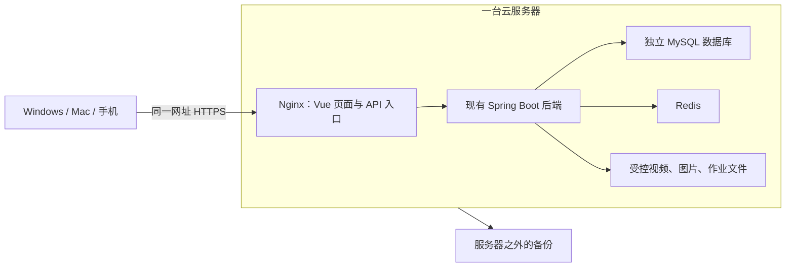

# UP-SELF 正式上线全流程与费用预算

核价日期：**2026-10-22**，时区 Asia/Shanghai。适用：马来西亚为主、10～30 名学生、现有学习/作业/每周心情 MVP。本文只做规划，没有购买、注册收费服务、开通云资源或实际部署，也没有修改参考项目。

导师需要简版时，直接看 [上线配套费用清单](导师简报_上线配套费用清单.md)：新增优先省钱的阿里云＋自管私有备份组合，并与本文件的DO/AWS方案分别列价。它是预算选型，不是已经取得的账号结账单。

价格标记：**核实价**来自下方官方公开页面；**预算预留**是为计算准备的假设，不是厂商报价；**待报价**表示尚未核实，不能用旧价或猜测补齐。最终付款以账号、地区、镜像、库存、税籍及结账页为准。正常运行预算不扣学生优惠、新用户试用金或限时促销。

## 1. 先看建议和总额

建议的起点是：**一台新加坡 Linux 云服务器，2 vCPU、4GB 内存、约 80GB 磁盘，运行 Vue 静态文件、现有 Java 后端、MySQL、Redis及受控上传文件；增加每日备份、一个普通域名和免费 HTTPS。** 这是单体部署，保持已有业务架构，不要求先购买独立数据库或媒体平台。

以 DigitalOcean Basic Regular 4GiB 配每日备份为可复核的主预算：

| 金额类型 | 本文预算 | 含义 |
|---|---:|---|
| 服务器＋每日备份 | US$31.20/月，税前 | 服务器 US$24，备份 US$7.20 |
| 上项含 8% SST、按 RM4.10/美元换算、再留 3%支付汇差 | **约 RM142.30/月** | SST 和换算假设见第 3 节 |
| 普通 `.com` 域名 | **预留 RM55/年** | 按年付款，不是每月再付 RM55 |
| 将域名按月分摊后的基线 | **约 RM146.88/月** | 不含超额、外包人工和未确定的授权费用 |
| 建议准备的日常月预算 | **RM150～180/月** | 差额是余量，不是一定会扣的钱 |
| 首次上线现金准备 | **建议 RM225～250** | 首月资源、全年域名及短时恢复测试/波动预留 |
| 连续一年 | **基线约 RM1,762.58；建议准备 RM2,100～2,200** | 基线按当前假设，余量用于波动及小额测试 |

2GB 可以作为更省钱的试用档：同平台服务器与每日备份在相同税/汇差假设下约 RM71.15/月，加域名分摊后约 RM75.73/月；建议准备 RM90～110/月。Java、MySQL、Redis同机的内存余量较小，必须先压测，不能把 30 个账号等同于 30 人同时流畅看视频。

上述金额**不是无条件的全部包干报价**。它们假设软件授权适用、使用自管服务器、视频及存储在套餐内、未购买人工托管或新业务服务。第 10 节列出了上线前仍需确认的版本和授权事项。

## 2. 什么叫两台电脑使用同一份数据

- 在这个网站里新增账号、提交作业、记录心情，都写进同一份线上数据库。另一台电脑刷新页面即可读取，权限仍按当前课程和本人关系判断。
- Git 同步代码；Flyway 迁移结构及版本化脚本。两者都不会自动合并两台本地数据库里的日常新增记录。
- 本地开发数据库继续独立。普通测试不直接写学生正式数据；发布代码不恢复旧快照覆盖线上库。
- 学生与导师只需要浏览器，不必在 Mac 上安装 Java/MySQL。若在 Mac 本地开发，另需补 macOS 启动支持，属于开发适配，不是每位用户都要买的服务。
- 当前实际使用服务器文件目录，`up-self-aliyun-oss` 尚未启用。本预算不把“先买 OSS”列为必选；历史决策稿中的 OSS 设想不覆盖现有实现。

源码依据：`environment/versions.json`、`up-self-admin/src/main/resources/application.yml`、`scripts/start.ps1`、`frontend/vite.config.ts`，以及作业、心情交付文档。当前运行版本为 Flyway V5。

## 3. 汇率、税、手续费怎样计算

1. **预算汇率**统一采用 **US$1＝RM4.10**。BNM 在 2026-10-22 展示的 USD 为 RM4.0820；这里四舍五入便于预算，不是银行卡实际结算价。[BNM 汇率](https://www.bnm.gov.my/exchange-rates)
2. **马来西亚 SST**：DigitalOcean 对税籍在马来西亚的客户目前收 8%；AWS Malaysia 对适用服务也列出 8%。服务器在新加坡不等于账单自动按新加坡税率计算。[DO 马来西亚税说明](https://docs.digitalocean.com/platform/billing/taxes/mys/)、[AWS 马来西亚税说明](https://aws.amazon.com/tax-help/malaysia/)
3. 其他公司的税以各自账单和税籍判断，不能把一个平台的说明当所有公司的结账规则；也不要向银行再缴一遍已经含在账单里的 SST。
4. 本文的 **3% 是支付/换汇总余量假设**，不是所有银行都收 3%。发卡行汇率价差、跨境费、PayPal 换汇等可能不同；如果已经采用含这些费用的实际换算价，就不重复叠加。具体费率需查自己的卡或支付渠道。
5. 注册时可能有验证预授权或最低充值。这是现金占用/预付，不应同时记成已消耗资源费和额外“开通费”；金额以真实支付页为准。
6. 所有公司页面的美元价都先按税前处理，除非该页面明确表示已含税。域名和可选服务是否收税分别核对。

通用预算式：`(服务器＋备份＋额外磁盘＋超额流量＋其他实际服务) × 适用税率因子 × 换算价 ＋ 年费项目当期现金支出`。不要用这个式子把未适用的税或费用强加到全部项目。

## 4. 云服务器公司与公开套餐对比

下表只比较**基础服务器**，还没加备份、税、支付汇差或域名。Linux/公网 IPv4 套餐优先；IPv6-only 的低价不能直接当作相同访问条件的报价。地区和可售规格购买前复核。

| 公司/产品 | 规格 | 套餐月流量 | 核实基础月价 | 仅按 RM4.10 换算 | 本项目判断与官方入口 |
|---|---|---|---:|---:|---|
| DigitalOcean Basic Regular | 1 vCPU / 2GiB / 50GiB | 2,000GiB | US$12 | RM49.20 | 节省试用档；[官网](https://www.digitalocean.com/)、[价格](https://www.digitalocean.com/pricing/droplets) |
| DigitalOcean Basic Regular | 2 vCPU / 4GiB / 80GiB | 4,000GiB | **US$24** | **RM98.40** | 主预算起点；同上价格页，选择 Singapore |
| AWS Lightsail Linux | 2 vCPU / 2GB / 60GB | 3TB，新加坡 | US$12 | RM49.20 | 节省试用档；[官网](https://aws.amazon.com/lightsail/)、[价格](https://aws.amazon.com/lightsail/pricing/) |
| AWS Lightsail Linux | 2 vCPU / 4GB / 80GB | 4TB，新加坡 | US$24 | RM98.40 | 相近的单机方案；同上价格页 |
| Alibaba Cloud 国际站轻量 Linux | 1 vCPU / 2GB / 40GB | 1.5TB | US$9 | RM36.90 | 公布峰值带宽 6Mbps，不宜只按人数判断视频体验；[官网](https://www.alibabacloud.com/)、[价格](https://www.alibabacloud.com/en/product/swas/pricing) |
| Alibaba Cloud 国际站轻量 Linux | 2 vCPU / 4GB / 80GB | 4TB | **US$19** | **RM77.90** | 公布峰值带宽 15Mbps；新加坡/吉隆坡的账号实际可购价仍须结账确认；同上价格页 |
| Akamai Cloud / Linode 4GB | 2共享 vCPU / 4GB / 80GB | 4TB，公开亚太套餐 | US$24 | RM98.40 | 新加坡规格/库存购买前复核；[官网](https://www.akamai.com/cloud)、[价格](https://www.akamai.com/cloud/pricing)、[亚太报价页面](https://www.akamai.com/cloud/pricing/asia-pacific?trk=article-ssr-frontend-pulse_little-text-block) |
| Vultr Cloud Compute | 待选择 Singapore 的实际 4GB 规格 | 待核实 | **待报价** | — | [官网](https://www.vultr.com/)、[价格](https://www.vultr.com/pricing/)；本次价格页返回 403，未拿非官方转载补价，也未计入总预算 |

阿里云公开页可核实 US$19 档及 15Mbps，但它不能据此被称为与其他主机完全相同的视频容量。例如每路视频平均 2Mbps，15Mbps 理论上只有约 7 路的量级，实际还要分给其他请求。峰值不是保证带宽，需用学生实际网络试播。[阿里云计费说明](https://www.alibabacloud.com/help/en/simple-application-server/product-overview/overview)

Lightsail 部分地区流量额度减半；本表按新加坡写，不把新加坡 4TB 直接当成马来西亚地区也有 4TB。选择吉隆坡或其他地区时应重新截图核对。[Lightsail 地区额度说明](https://aws.amazon.com/lightsail/pricing/)

如果坚持与本机相同的 Windows 启动方式，Lightsail Windows 的 4GB/80GB 档公开价为 US$44/月，8GB/160GB 为 US$74/月，均未加备份和税。Windows 自身也占内存。它减少部分系统适配工作，但不是上述 US$24 Linux 预算；不因客户端有 Windows/Mac 就必须购买 Windows 服务器。[Windows 套餐](https://aws.amazon.com/lightsail/pricing/)

## 5. 备份、快照、扩盘和流量费用

### 5.1 备份不能漏算，也不要重复买

| 方式 | 官方计价或本轮预算 | 说明 |
|---|---|---|
| DO 每周 / 每日备份 | 实例费的 20% / 30% | US$24 主机对应 US$4.80 / US$7.20；主预算选每日。频率及保留规则按开通页确认。[价格](https://www.digitalocean.com/pricing/droplets) |
| Lightsail 实例/磁盘快照 | **US$0.05/GB/月** | 按实际计费快照数据，不是固定加 20%。4GB 主机先预留 US$2～8/月，相当于约 40～160GB 的计费存储假设，不是厂商保证上限。[价格](https://aws.amazon.com/lightsail/pricing/) |
| Linode 4GB Backups | 官方备份表列 **US$5/月** | 配置、自动备份保留与 DO 不完全相同，不能只比总价就宣称恢复能力一样。[备份价格](https://www.akamai.com/cloud/pricing/backups)、[备份说明](https://techdocs.akamai.com/cloud-computing/docs/backup-service) |
| 阿里云轻量快照/外部备份 | **待账号和地区核实** | 核对免费限额、可留份数、到期释放及数据盘范围，不能默认含永久异地备份。[账单项目](https://www.alibabacloud.com/help/en/simple-application-server/product-overview/billable-items) |
| 私有备份副本下载到自己的电脑 | 备份软件可为 RM0；传输仍占网络额度 | 需定期真正执行；电脑上副本存在、可恢复才算备份，不把 Git 当持续业务备份 |

每日数据库一致性导出、匹配文件副本、云端备份和恢复验证应形成一个流程。只存在同一块运行磁盘上的 SQL 不足以应对整机损失；仅有云整机快照也不能替代 MySQL 一致性及恢复验证。基础目标为每日备份，故障时可能丢失最近约一天的新数据；单机仍可能停机，并不提供无中断切换。

主预算已含服务器之外的厂商备份。再购买其他云存储属于可选的第二份备份，不需要无理由同时付三家费用。

### 5.2 可选的额外私有备份存储

仅作费用备查，本期不接入新应用存储 SDK，也不把这些服务列为购物必选：

| 公司 | 当前公开计价 | 常见小费用/限制 | 官方网址 |
|---|---|---|---|
| Backblaze B2 | US$6.95/TB/月，按存储量计；不是必须先买满 1TB | 保留多版本会增加总存储；有读取/恢复及出网条件。50GB 按十进制粗算存储约 US$0.35/月，税、传输条件另核 | [价格](https://www.backblaze.com/cloud-storage/pricing) |
| Cloudflare R2 Standard | US$0.015/GB/月；10GB-month 免费额度 | A 类请求 US$4.50/百万、B 类 US$0.36/百万，有各自免费额度；互联网出网免费不代表 VPS 向它发送数据也不占 VPS 出网 | [价格与免费额度](https://developers.cloudflare.com/r2/pricing/) |
| 阿里云 OSS | 存储、请求、外网下载等分别计费，地区不同 | 当前工程仅保留模块边界，未启用；如以后启用，要按现有 SDK 和权限方式另行核算，不能拿 VM 的流量额度抵扣 OSS 账单 | [价格](https://www.alibabacloud.com/en/product/oss/pricing) |

R2、B2、OSS 的“50GB”必须指**全部保留备份的总量**，不是原始文件 50GB 却保存 30 份仍只付 50GB。跨区复制、低频存储提前删除、归档恢复、加速等功能若开通，单列对应账单，不混入本期标准存储假设。

外部备份的实际存储地区也要核对；新加坡主机不代表第三方备份自动留在新加坡或马来西亚。若学校要求特定地区存放，先筛选符合要求的服务，再比较费用。

### 5.3 流量通常已经包含，超额才另算

本地测试多为本机传输；上线后学生观看会发生云端向外传输。上传存储量、下载流量、网络带宽是三个不同量，套餐里的流量不是每次上传都要另买。

| 项目 | 可核实规则 | 预算影响 |
|---|---|---|
| DO Droplet | 入站免费，超额出站 US$0.01/GiB；额度按团队累计 | 超额 100GiB 约 US$1；短期开机的流量额度并不保证等于一整月额度。[计费规则](https://docs.digitalocean.com/platform/billing/bandwidth/) |
| Lightsail 新加坡 | 入站和出站都计入套餐额度；超额出站当地为 US$0.12/GB | 超额 100GB 约 US$12，未含税。[官方流量规则](https://docs.aws.amazon.com/lightsail/latest/userguide/amazon-lightsail-faq-data-transfer-allowance.html) |
| 阿里云轻量 | 超套餐后按地区出网计价；公开页 Singapore US$0.081/GB，Kuala Lumpur US$0.077/GB | 超额 100GB 对应约 US$8.10 / US$7.70，未含税；实际按当前结账地区计费。[价格](https://www.alibabacloud.com/en/product/swas/pricing) |
| Linode 普通计算区 | 公布超额出网 US$0.005/GB；特定分布式区域规则不同 | 不把普通区费率直接套到所有区域。[价格](https://www.akamai.com/cloud/pricing) |

例：20 个 100MB 视频，文件本身约 2GB；30 人各完整看两遍约产生 120GB 播放传输。重复观看、快进重新请求、其他附件、部署及备份传输会影响实际值。30 人同时以 2Mbps 看视频则约需 60Mbps 的播放带宽；“套餐剩余流量很多”并不能解决峰值带宽不足。

磁盘也应保留系统、MySQL、日志及临时备份空间，不能把 80GB 全部承诺给视频。需要扩盘时会产生单独卷费；换大机通常要按新价长期付。Lightsail 额外块存储公开为 US$0.10/GB/月，32GB 为 US$3.20/月；其他平台应分别核价，不当成通用费率。[Lightsail 磁盘价格](https://aws.amazon.com/lightsail/pricing/)

## 6. 域名、DNS、HTTPS和公网 IP

### 6.1 域名公司：首年、续费、附加项分开看

以下是普通、非溢价 `.com` 的公开页面信息，**没有查询或承诺某个具体名称可注册**：

| 公司 | 首年 | 一年续费 | 小费用与条件 | 官网/价格 |
|---|---:|---:|---|---|
| Porkbun | US$11.08 | US$11.08 | 页面当日三项同价；实际税、币种及支付页总额核对，域名隐私条件看后缀 | [公司及价格](https://porkbun.com/products/domains) |
| Namecheap | 常规页面 US$14.98，当前首年折扣 US$11.28 | US$18.48 | 部分后缀另加 ICANN US$0.20；`.com` 购买时核对该项。不把新客 US$6.48 当长期年费 | [`.com` 价格](https://www.namecheap.com/domains/registration/gtld/com/) |
| Cloudflare Registrar | 按具体名字/后缀查询 | 按当前注册局成本 | 未登录核到稳定 `.com` 结账数值，**不填写猜测价**；需核对域名与 DNS 使用条件 | [域名入口](https://www.cloudflare.com/domains/) |

本次按普通 `.com` 预留 **RM55/年**；这是假设选择低价普通域名的预算额度，不是所有注册商都只收 RM55。若选 Namecheap，续费、ICANN与支付费用后应另算。域名溢价、赎回、逾期恢复、转入以及额外后缀保护是条件性费用，不属于正常首年必付。转移有时含续期，需防止把续期重复记账。域名按年付，首月现金不能只拿“年费÷12”付款。

一个已核实的异常费用例子：Porkbun 当日价格页注明，进入 Redemption Grace Period 后的恢复费为 **US$200，另加正常续费**。这是可通过及时续费避免的异常支出，不加入正常 RM55 年费预算。[价格页的恢复费说明](https://porkbun.com/products/domains)

### 6.2 不需要为这些基础项重复付款

| 项目 | 本期选择与费用 | 细节 |
|---|---|---|
| DNS 解析 | 用注册商基础 DNS 或 Cloudflare Free，RM0 可行 | 一个网站无需默认购买 Premium DNS；Cloudflare 入口：[免费计划](https://www.cloudflare.com/plans/free/) |
| HTTPS 证书 | Let's Encrypt，证书费用 RM0 | 配置自动续期和检查到期仍需维护时间；免费不等于不会过期。[官网说明](https://letsencrypt.org/about/) |
| 主公网 IPv4 | 选择已包含 IPv4 的对应 VPS 套餐 | 不再默认叠加一份普通 EC2 公网 IP 费用；独立保留/闲置/额外 IP 按所选产品规则另查 |
| Lightsail 静态 IP | 附加在实例上时免费 | 脱离实例超过 1 小时后公开规则为 US$0.005/小时，约 US$3.60/30 天；需要及时释放。[官方规则](https://docs.aws.amazon.com/lightsail/latest/userguide/amazon-lightsail-frequently-asked-questions-faq-billing-and-account-management.html) |
| 网站入口与反向代理 | 开源 Nginx 软件可为 RM0 | 运行资源已计入云主机，不按用户人数再收一遍网页服务器费；配置、排错是人工时间 |
| 基础防火墙 | 用服务器本机防火墙，软件费 RM0 | 云厂商付费高级防护不是本期默认采购项；基础规则仍须配置 |

视频和私人附件继续由后端鉴权，不把上传目录配置成无条件公开下载。Cloudflare 免费 DNS 可以独立使用；若开启其代理，Free/Pro 的请求上传上限为 100MB，与当前后端单文件 100MB/请求 105MB 的边界可能冲突，必须实测，不能认为花钱升级代理是唯一解法。[Cloudflare 上传限制](https://developers.cloudflare.com/support/troubleshooting/http-status-codes/4xx-client-error/error-413/)

## 7. 全部费用项目检查表

“当前为 0”表示现有范围下不必额外花钱，并不表示以后开通任何同类服务都免费。

| 费用项目 | 是否必需 | 当前处理/金额依据 |
|---|---|---|
| 线上服务器计算、系统盘及套餐流量 | 必需 | 选第 4 节一套，不能同时把三家主机都算成必买 |
| 普通域名年费、续费、ICANN/税 | 本方案采用 | 第 6 节，按年付；可用子域名也须确认来源和控制权 |
| 备份存储/整机备份 | 真实学生试用需要 | 主预算包含每日厂商备份；数据库及文件一致性另做恢复验证 |
| 额外磁盘、快照保留、多版本备份 | 条件性 | 超出主预算假设时收费；旧快照不应无限积累 |
| 流量超额、跨区、备份传输、迁移下载 | 条件性 | 第 5 节；不要因“上传免费”就误认为所有云流量免费 |
| SST/其他适用税 | 条件成立时必付 | DO/AWS Malaysia 当前为适用账单 8%；其他供应商及域名单独核对 |
| 外币价差、跨境/支付渠道费 | 视支付方式 | 3%仅预算余量；实际以发卡行及账单为准，不重复计价 |
| 支付验证预授权、最低充值 | 可能占用现金 | 以开通页为准，预授权释放不是退款收益，也不等于月租已付 |
| 独立托管 MySQL/Redis | 本期不采购 | 同机自建已算服务器资源；托管数据库不是当前架构运行的必选订阅 |
| JDK/软件许可与商用镜像 | 上线前确认 | 不默认 Oracle JDK 8u231 的所有用途免费；见第 10 节，无法确定时单列待报价 |
| Windows 系统镜像 | 仅选 Windows 时 | 使用对应 Windows 套餐；不把 Linux 价当 Windows 实付 |
| DNS/证书/基础网页服务 | 可额外现金 RM0 | 第 6 节，运维时间仍存在；不勾选附加付费包 |
| CDN/转码/视频托管 | 本期不采购 | 先用现有视频播放与文件存储；视频增长后根据真实数据再评估 |
| 对象存储 API 请求/取回/提前删除 | 仅启用相应存储时 | 第 5 节；“免出网”不等于整个服务免费 |
| 网站监测 | 免费档或已有工具可起步 | [UptimeRobot](https://uptimerobot.com/pricing/) 免费计划标为业余/非营利用途，先核对项目是否符合，间隔及告警受限；SMS/电话等渠道不能默认免费 |
| 日志平台/错误跟踪 | 本期不采购付费平台 | 日志轮转和磁盘占用由服务器承担；不无限记录、保留学生备注或密码 |
| 发信服务、品牌邮箱 | 当前没有邮件功能，不采购 | 后续需要密码邮件/通知时才核量；[Resend](https://resend.com/pricing)、[Amazon SES](https://aws.amazon.com/ses/pricing/)；邮箱收件账户和发信 API 不是同一项 |
| 短信、WhatsApp/电话通知 | 当前不启用，RM0 | 不为本期账号密码登录购买 OTP/SMS 套餐 |
| AI、外部会议付费账户 | 当前不启用，RM0 | 帖子保存会议链接，不等于网站购买了会议服务；人工智能不在本期上线范围 |
| Git 仓库与自动化构建 | 手工本地构建可不新增月费 | 不需要为发布就购买付费 CI；将来使用 Actions 核对免费额度/运行分钟/制品存储。[GitHub 价格](https://github.com/pricing)、[Actions 计费](https://docs.github.com/en/billing/managing-billing-for-your-products/managing-billing-for-github-actions/about-billing-for-github-actions) |
| 初次 Linux/生产适配、部署人工 | 工作必需，外部现金视人选 | 自己做可无外包付款，但不是零工时；委托他人需拿分项报价 |
| 日常运维、升级、告警处理、恢复人工 | 持续工作 | 自管云主机不包含替你维护业务应用；若购买托管/值班服务，另列月费 |
| 字幕、图片说明、课程材料与素材授权 | 内容工作实际需要 | 可自己制作；若委托制作或购买素材另报价，不把 inclusive 内容准备计成服务器功能已自动完成 |
| 学校审批、隐私说明及必要咨询 | 按实际要求 | 涉学生心情/私人备注，确认学校及适用要求；如要求外部审核/法律服务，询价后单列，本文不编统一金额 |
| 双机迁移/恢复演练/临时测试服务器 | 短期可能需要 | 另留 RM5～25 的资源预算假设，结束后真正删除临时资源；人工另算 |
| 逾期、域名赎回、遗留资源 | 可以预防的费用 | 自动续费与账单提醒需设置；删除应用不等于取消所有云资源 |
| 客户端开发软件/本机网费/开发辅助订阅 | 不属于网站托管月租 | 已有设备和网络不重复算购置费；实际新增支出由个人账单另列，不能把 AI 工具订阅当网站运行必需 |

付费支持、托管数据库、存储 API、外包及授权等未确定项不在基线包干内。需要它们时，填写报价后重算总额，不能认为已经由 RM150～180 永久覆盖。

## 8. 主预算的详细付款与年度现金流

### 8.1 每月计算

| 项目 | 计算 | 费用 |
|---|---|---:|
| 主机 | DO Basic Regular 4GiB | US$24.00 |
| 每日备份 | US$24 × 30% | US$7.20 |
| 税前合计 | 24＋7.20 | US$31.20 |
| 马来西亚适用 SST | 31.20 × 8% | US$2.496 |
| 含税后换算 | 33.696 × RM4.10 | RM138.1536 |
| 支付/汇差余量假设 | 上项 × 3% | RM4.144608 |
| 月付资源预算 | 汇总后四舍五入 | **RM142.30** |
| 域名年度预算按月展示 | RM55 ÷ 12 | 约 RM4.58；不是实际按月扣款 |
| 月平均基线 | 按未四舍五入值汇总 | **RM146.88** |
| 应急余量 | 留至预算上限，不是厂商收费 | 建议日常总预算 RM150～180 |

R2/B2、付费 CDN、付费邮箱、独立数据库、付费告警均没有偷塞入上述主预算。若后来购买，应列为新增行；厂商每日备份也没有和其他云备份重复算成必买。

### 8.2 从首次开通开始准备多少现金

| 使用时长 | 月付资源＋一次全年域名的基线 | 说明 |
|---|---:|---|
| 第一个月 | **RM197.30** | 142.30 左右资源＋55 域名；还未加临时测试/应急余量 |
| 三个月 | **RM481.89** | 资源按三个月，域名只付一次 |
| 六个月 | **RM908.79** | 资源按六个月，域名只付一次 |
| 十二个月 | **RM1,762.58** | 资源按十二个月，域名只付一次 |

按原始小数计算后四舍五入，表内可能与“先把每月数四舍五入再相乘”差一分钱。域名 RM55 是预算预留，不是 Porkbun 的固定马币报价。

首次准备 RM225～250、平时 RM150～180/月、一年准备约 RM2,100～2,200，可以覆盖上述基本场景和一定余量。**没有覆盖尚未报价的外包人工、授权订阅或大幅视频增长。** 不能把云资源费当整站开发费；如果短期用优惠金，仍要按优惠到期后的月费准备现金。

### 8.3 其他公司怎样套入，而不是凭感觉比价

- Lightsail 4GB：服务器 US$24，加快照预算 US$2～8；若适用相同 8% SST、RM4.10 和 3%余量，月付资源约 **RM118.58～145.95**，再加域名年费。快照数据增长时这个范围会变，不是封顶价。
- Linode 4GB：公开基础价 US$24，加备份 US$5，税前 US$29。该账号实际税项须确认，不能无凭据套上 DO 的税规则。
- 阿里云轻量 4GB：公开基础价 US$19，但还要核对实际地区、15Mbps 视频表现、备份范围、税及续费后价格，再形成完整付款单。不能直接用 US$19 与已含每日备份、SST 的 RM142.30 比。
- Vultr：官方页面本次无法完整核价，保留网址和待报价行；没有用转载价填一个“保证更便宜”的总额。

## 9. 真正上线的完整顺序及每一步费用

| 阶段 | 要做的具体工作 | 产生/核对的费用 | 完成依据 |
|---|---|---|---|
| 1. 固定上线范围 | 确认三角色、受邀 10～30 人、课程/作业/周心情及英文 inclusive 页面 | 不为未来群聊/AI 先采购；课程材料制作或授权若委托另计 | 用户流程及可展示内容明确 |
| 2. 确认运行环境 | 核对 Linux x86_64、JDK 发行版/许可、MySQL 5.7.44、Redis 上游版本与当前 Windows 移植版差异 | 软件授权可能待确认；部署适配人工另计；不能直接花钱买“最新版镜像”当已兼容 | 运行清单与最小变更获得确认 |
| 3. 确认数据存放地区 | 优先新加坡；若学校要求马来西亚存储，改核吉隆坡实际套餐 | 地区价格、税和可购性重新核对，不默认都同价 | 地区和隐私/学校要求满足 |
| 4. 注册云账号与支付 | 用本人可管理的账号设置账单联系人、支付、登录保护和费用提醒 | 税、预授权/预付、换汇；试用金有效期 | 付款页逐项截图和预算记录 |
| 5. 购买月付资源 | 创建一台合适规格主机，开选定备份 | 从创建/购买开始产生租金；不先买一年 | 机器实际规格、地区、价格与预算一致 |
| 6. 购买域名和配置 DNS | 选择普通可注册名称，确认续费、控制权 | 整年域名现金支出、ICANN及适用税；基础 DNS 可 RM0 | 域名可解析到该服务器 |
| 7. 准备生产配置 | 安装确认版本，独立线上配置/密钥，Linux 启停/开机自启，进程日志轮转 | 主要为人工，软件按授权处理；不更改参考工程 | 重启服务器后能恢复运行 |
| 8. 首次迁移数据库和文件 | 暂停源端写入，导出实际数据库/匹配文件；仅向空的独立线上库恢复；核 V1～V5 | 网络额度、磁盘、迁移/恢复人工；若另开验证机按时计费 | 账号哈希、表/迁移、媒体/附件一致 |
| 9. 配置网页入口与 HTTPS | 本机构建 Vue/Java后发布；Nginx 静态页面/API 反代；证书自动续期 | 证书 RM0，部署人工；云端构建若另开机器产生租金 | HTTPS 正常，上传/视频 Range/超时/大小限制一致 |
| 10. 验证权限及 inclusive | 三角色实测建课、导师资源/帖子、作业提交/批改、每周心情/私人备注；键盘、移动端、字幕/替代说明 | 自己测试可无外包付款，工时和内容制作仍需考虑 | Windows/Mac/手机真实流程通过 |
| 11. 做一次恢复及负载演练 | 新空库/临时机验证恢复；按学生实际网络测视频及并发 | 可临时计费、恢复下载/快照；预留 RM5～25 资源费，不含外包人工 | 恢复后可登录；备份确实可用；容量有实测 |
| 12. 邀请小批学生 | 建立正式账号、提示权限与隐私范围；不放任演示/测试数据混入 | 无需短信或邮件就能采用现有管理员建号流程；如另启服务另算 | 先小批使用，观察真实访问和反馈 |
| 13. 持续维护 | 每日备份检查、磁盘/账单检查、证书续期、错误和权限问题处理 | 月租/备份/税/域名续费；维护人工；增长项见表 | 每月核账并记录实际量，不把提醒当费用硬封顶 |
| 14. 发布新版本 | 先备份，替换构建产物，Flyway 只执行新增版本；保留线上数据库和文件 | 操作人工、必要短时验证资源 | 不运行旧 Restore 覆盖学生最新数据 |
| 15. 结束试用/交接 | 导出可恢复副本、确定数据保留/删除，处理域名续费，删除不再需要的云资源 | 备份下载、残留快照/卷/IP/对象存储、续费 | 资源清单和下期账单复核，不能只关闭应用窗口 |

本地 Windows 的 `.cmd/.ps1` 不等同于已经完成 Linux 上线。现有跨电脑教程是 Windows 开发迁移教程；本文是生产上线规划，两份文档用途不同。

## 10. 上线前必须确认的实际版本与人工成本

- **JDK 有真实差异**：本机版本表为 Oracle JDK 8u231；只读检查参考项目 `C:\Users\eggma\Desktop\project\fts_admin_ac\Dockerfile:1` 为 `amazoncorretto:8u362`。Oracle 对 8u211 之后的免费用途有许可范围，不能由“我能下载安装”推定任何线上运行都免费。[Oracle 许可 FAQ](https://www.oracle.com/java/technologies/javase/jdk-faqs.html)
- 参考使用的 Corretto 是免费开源发行版，官方说明其使用/分发不收费，但这不意味着可以未经确认替换当前 JDK 补丁号。上线前对齐既有参考部署方式、兼容性和许可；不必为了免费 JDK 被迫买 AWS 主机。[Corretto 费用与许可](https://aws.amazon.com/corretto/faqs/)
- **Redis Windows 5.0.14.1 不能照搬 Linux 安装**，需要确认对应上游版本、配置和权限。没有在本文改版本或承诺任意 Linux 镜像已经验证可用。
- **MySQL 5.7.44 是 5.7 最终发行版**，活跃开发已结束。维持旧版本的维护方式及真实学生数据上线条件应事先确认；若最后确需调整，提供具体兼容性/风险依据及最小方案，另行确认，不擅自升级整套技术栈。[MySQL 官方版本说明](https://dev.mysql.com/doc/refman/26.7/en/faqs-general.html)
- 线上凭据使用独立配置和新的线上密钥。当前 Git 中已按所有者要求保存本地真实配置，这不等于该本地密钥必须继续承担正式网站认证。数据库/Redis仅服务器内部可达；业务备份含私人数据，应采用受限访问及适当加密。
- 自管服务器的系统、数据库和业务运维是我们的责任。若委托他人，索取“初次部署、Linux适配、数据迁移、备份恢复、域名证书、每月维护、故障恢复、交接”分项报价，写明是否包含额外平台费用及税。本文没有调查承包市场价，不编一个外包统一价格。

**费用确认门槛**：若最终 JDK/系统/支持方式需要付费授权或付费维护，将真实报价加入表格后再确认最终总额。本文 RM150～180 的常规资源预算不能被解释为未知许可证及无限人工都已包在里面。

## 11. 防止小费用长期积累

1. 云主机关机/停止 Java通常不等于停止资源计费。DO 明确说明创建到销毁之间收费，关机仍收费；订阅轻量按已购期间计费，停止应用不会自动退款。[DO 计费](https://docs.digitalocean.com/products/droplets/details/pricing/)、[阿里云订阅规则](https://www.alibabacloud.com/help/en/simple-application-server/product-overview/overview)
2. 临时恢复机、旧磁盘、旧快照、空闲 IP、对象存储、多区域副本分别列清单；销毁主机前先验证备份，销毁后再核对这些资源。
3. 域名、服务器、证书都有续期问题：证书免费但会过期；付费域名/订阅服务器欠费可能停止服务甚至释放数据。
4. 域名购物车常有邮箱、证书、Premium DNS、建站等附加项；只保留真实需要的服务。价格看续费总额，别只看首年宣传。
5. 避免把完整私人媒体和账号会话设为公共缓存来“省流量”；视频/文件权限和备份权限保留。
6. 每月记实际服务器费、备份费、磁盘使用量、流量、税、支付换算与域名续期日。费用提醒只是通知，不是自动停止收费的硬上限。

## 12. 公司与官方网站速查

| 类别 | 公司/组织 | 用途及官方链接 |
|---|---|---|
| 云主机 | DigitalOcean | [公司](https://www.digitalocean.com/)、[主机与备份价格](https://www.digitalocean.com/pricing/droplets)、[税](https://docs.digitalocean.com/platform/billing/taxes/mys/)、[流量](https://docs.digitalocean.com/platform/billing/bandwidth/) |
| 云主机 | AWS Lightsail | [产品](https://aws.amazon.com/lightsail/)、[完整价格](https://aws.amazon.com/lightsail/pricing/)、[马来西亚税](https://aws.amazon.com/tax-help/malaysia/)、[流量](https://docs.aws.amazon.com/lightsail/latest/userguide/amazon-lightsail-faq-data-transfer-allowance.html) |
| 云主机 | Alibaba Cloud 国际站 | [公司](https://www.alibabacloud.com/)、[轻量价格](https://www.alibabacloud.com/en/product/swas/pricing)、[账单项目](https://www.alibabacloud.com/help/en/simple-application-server/product-overview/billable-items) |
| 云主机 | Akamai / Linode | [公司](https://www.akamai.com/cloud)、[价格](https://www.akamai.com/cloud/pricing)、[备份价格](https://www.akamai.com/cloud/pricing/backups) |
| 云主机，待报价 | Vultr | [公司](https://www.vultr.com/)、[价格](https://www.vultr.com/pricing/)、[备份计费](https://docs.vultr.com/support/platform/billing/how-much-does-it-cost-to-enable-automatic-backups)；主机价本次未核实 |
| 域名 | Porkbun | [价格](https://porkbun.com/products/domains) |
| 域名 | Namecheap | [`.com` 首年/续费/ICANN](https://www.namecheap.com/domains/registration/gtld/com/) |
| 域名/DNS，可选备份 | Cloudflare | [域名](https://www.cloudflare.com/domains/)、[免费计划](https://www.cloudflare.com/plans/free/)、[R2价格](https://developers.cloudflare.com/r2/pricing/) |
| 免费 HTTPS | Let's Encrypt | [官网及免费证书说明](https://letsencrypt.org/about/) |
| 可选备份 | Backblaze B2 | [价格](https://www.backblaze.com/cloud-storage/pricing) |
| 后续应用文件存储备查 | 阿里云 OSS | [价格](https://www.alibabacloud.com/en/product/oss/pricing)；本期未启用 |
| 可选可用性监测 | UptimeRobot | [价格/免费档](https://uptimerobot.com/pricing/) |
| 未来邮件 | Resend / Amazon SES | [Resend](https://resend.com/pricing)、[SES](https://aws.amazon.com/ses/pricing/)；当前不购买 |
| 代码及未来 CI | GitHub | [价格](https://github.com/pricing)、[Actions计费](https://docs.github.com/en/billing/managing-billing-for-your-products/managing-billing-for-github-actions/about-billing-for-github-actions) |
| JDK 授权 | Oracle / Amazon Corretto | [Oracle FAQ](https://www.oracle.com/java/technologies/javase/jdk-faqs.html)、[Corretto FAQ](https://aws.amazon.com/corretto/faqs/) |
| 汇率 | Bank Negara Malaysia | [汇率](https://www.bnm.gov.my/exchange-rates) |

### 本次核价限制

公开价格不等于账号下单成功：尚未登录任何供应商购买控制台，也没有确认你具体银行卡费率、域名可用性、地区库存或学校资源。Vultr 主机价格本次访问被 403 拦截；Akamai 的部分页面发生重定向，4GB/备份金额以当日可检索官方亚太/备份表为依据，购买时再次确认。所有未确认项明确保留，不拿博客转载或历史宣传价当最终报价。

## 13. 与已有交付文档的关系

- [跨电脑环境安装与启动教程](跨电脑环境安装与启动教程.md)：Windows 开发环境与实际快照迁移。
- [三角色与作业模块交付验收](三角色与作业模块交付验收.md)：现有业务能力与权限。
- [每周心情模块交付与验收](每周心情模块交付与验收.md)：心情知情确认、导师只读与私人备注隔离。
- [早期 MVP 决策稿](UP-SELF_MVP范围与权限部署预算决策稿.md)：保留需求历史；部署费用、当前存储与本次实际范围以本文及较新交付为准。

本文可作为后续开通前的费用核对单。下一次要实际部署时，先形成“厂商/地区/规格、真实结账价、备份策略、域名、税、支付方式、JDK及服务版本、一次性人工”完整付款清单，再按第 9 节执行。
